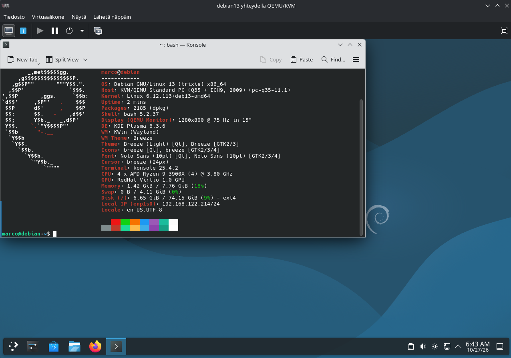

# H2 — Current Cybersecurity Scene

**Cyber Security · Haaga-Helia · Autumn 2026**

This report covers a cybersecurity podcast, a current threat landscape report, and a connection between recent threats and healthcare cybersecurity research.

---

## a) Podcast — Tietomurron anatomia

| | |
|---|---|
| **Podcast** | Herrasmieshakkerit |
| **Episode** | *Tietomurron anatomia*, featuring Antti Kurittu (0x3e) |
| **Published** | 27 November 2025 |
| **Duration** | 71 minutes |
| **Hosts** | Mikko Hyppönen and Tomi Tuominen |

### Summary

Mikko Hyppönen and Tomi Tuominen discuss cybersecurity, hacking culture and security technologies with Antti Kurittu.

The topics include **Apple's Memory Integrity Enforcement**, a technology designed to make certain memory vulnerabilities harder to exploit. The episode also references Linus Nyman's book *Hyvät Hakkerit* and the documentary series *Most Wanted: Julius Kivimäki*, which relates to a major Finnish cybercrime case.

### Key takeaways

- **Software security:** Reducing exploitable vulnerabilities helps prevent attacks.
- **Real-world impact:** Cybercrime can affect people and organisations, not just technical systems.
- **Hacking culture:** Understanding motivations and practices provides useful context for cybersecurity.

### My reflection

> What interests me most is the connection between technical security and the real-world consequences of cybercrime. I work with healthcare information systems, where sensitive patient data must be protected. The Vastaamo case shows how serious a data breach can be for individuals and healthcare organisations.

**Source:** [Herrasmieshakkerit — Tietomurron anatomia (0x3e)](https://podcasters.spotify.com/pod/show/herrasmieshakkerit/episodes/Tietomurron-anatomia--vieraana-Antti-Kurittu--0x3e-e3oh0km)

---

## b) Blog — Finland's Cybersecurity Threats in 2026

**Publisher:** Traficom / National Cyber Security Centre Finland (NCSC-FI)  
**Published:** 16 June 2026  
**Article:** *Cybersecurity in the first half of 2026: countering cyber threats requires stronger preparedness and resourcing*

### Key findings

- **Microsoft 365 and phishing:** Adversary-in-the-Middle (AiTM) attacks can steal session tokens and bypass some traditional MFA protections. Compromised accounts can be used for further phishing.
- **Artificial intelligence:** Attackers use AI for reconnaissance, vulnerability discovery and convincing scams. AI systems themselves are also targets of manipulation.
- **Faster exploitation:** Vulnerabilities may be exploited shortly after disclosure, increasing the importance of prompt updates.
- **Supply chains:** Weaknesses in software suppliers, cloud services and connected devices can expose other organisations.
- **Network edge devices:** Exposed VPN gateways, firewalls and routers are attractive targets for cybercrime and espionage.
- **Preparedness:** Strong authentication, monitoring, staff training, patching and risk management need ongoing attention and resources.

### Main point

Finland's cybersecurity situation remained broadly stable in early 2026, but attack techniques continued to evolve. **Cybersecurity preparedness must be part of everyday operations**, not just a reaction to incidents.

**Source:** [Traficom — NCSC News](https://www.kyberturvallisuuskeskus.fi/en/ncsc-news?limit=20&offset=0&query=&sort=updated)

---

## c) Science That — Linking Research to Current Threats

**Research:** Auz-Torres & Yoo (2026), a systematic literature review on healthcare cybersecurity published in *IEEE Access* ([DOI: 10.1109/ACCESS.2026.3667073](https://doi.org/10.1109/ACCESS.2026.3667073)).

### Connection between the sources

- **Traficom** describes current threats: account takeovers, AI-assisted phishing, vulnerable software and supply-chain attacks.
- **Auz-Torres & Yoo** reviewed **71 scientific articles** and grouped healthcare cybersecurity factors into four areas: **technological, human, organisational and physical**.
- **Shared message:** Technology alone is not enough. Staff awareness, risk management, updates and continuous monitoring also matter.
- **Different perspectives:** Traficom offers an up-to-date national threat picture; the review provides a broader research-based framework for healthcare security.

### My reflection

The sources complement each other: Traficom explains **what is happening now**, while the research helps explain **how healthcare organisations can prepare**. In hospitals, older medical devices and reliance on external vendors can complicate vulnerability management.

> **My question:** How can hospitals maintain strong cybersecurity when critical medical devices cannot be updated without vendor approval?

**Sources:** [Traficom / NCSC-FI](https://www.kyberturvallisuuskeskus.fi/en/ncsc-news?limit=20&offset=0&query=&sort=updated) · [Auz-Torres & Yoo (2026)](https://doi.org/10.1109/ACCESS.2026.3667073)

---

## Bonus — Debian 13 Virtual Machine

I installed **Debian GNU/Linux 13 (Trixie)** in a **QEMU/KVM virtual machine** as a practical environment for cybersecurity exercises. The installation was successful, and the system is running the KDE Plasma desktop.

### Virtual machine specifications

| Component | Configuration |
|---|---|
| Operating system | Debian 13 (Trixie), x86_64 |
| Virtualization | QEMU/KVM |
| Desktop | KDE Plasma 6.3.6 (Wayland) |
| Kernel | Linux 6.12.113+deb13-amd64 |
| CPU | 4 virtual CPUs (AMD Ryzen 9 3900X) |
| Memory | Approximately 8 GB |
| Storage | Approximately 74 GiB root filesystem (ext4) |
| Graphics | Virtio GPU |

### Verification

I used `fastfetch` to check the installed operating system, desktop environment and virtual hardware:

```bash
fastfetch
```



*Figure 1. Debian 13 running in QEMU/KVM, with system details displayed using Fastfetch.*
