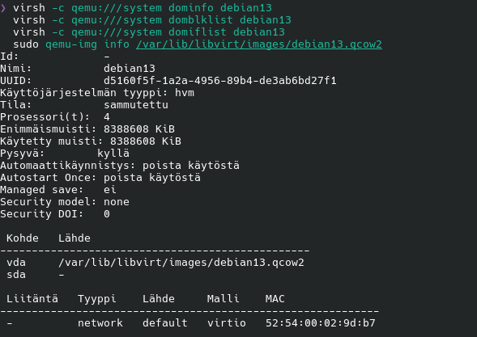
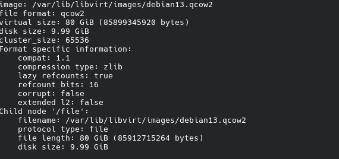
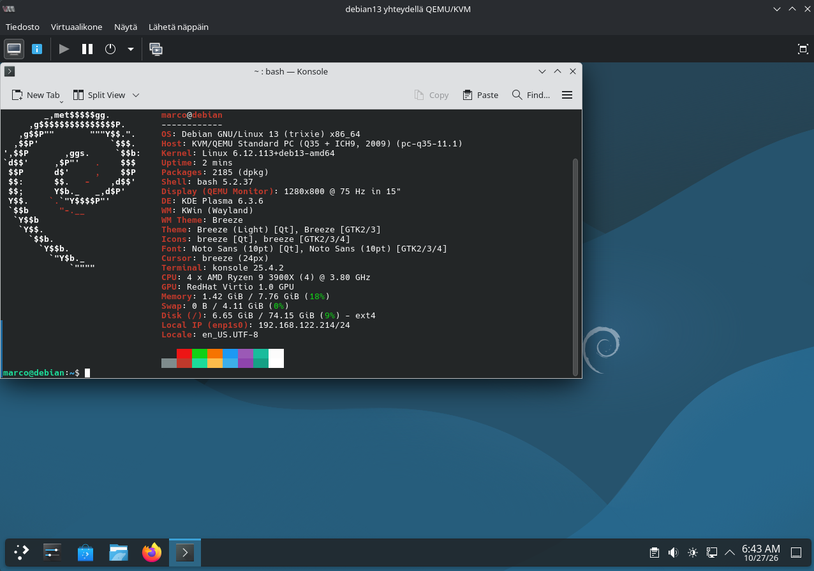
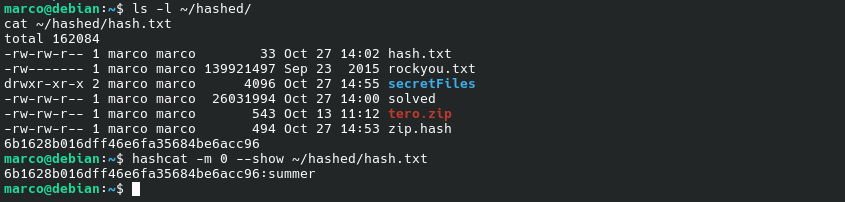
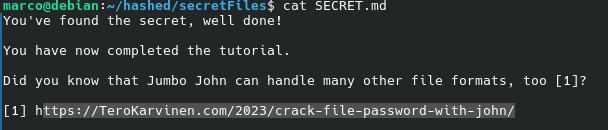
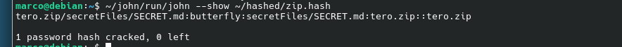

# H3 — Linux and Password Cracking

**Cyber Security · Haaga-Helia · Autumn 2026**  
**Environment:** Debian 13 (Trixie), QEMU/KVM virtual machine on CachyOS Linux

This report covers Linux command-line basics, installation and configuration of a Debian virtual machine, a Hashcat exercise, and the optional John the Ripper Jumbo ZIP-password exercise.

---

## x) Read and Summarize

### Karvinen (2020): Command Line Basics Revisited

- Linux commands such as `pwd`, `ls`, `cd`, `less`, and `nano` make file navigation and editing efficient.
- File operations include `mkdir`, `mv`, `cp`, `rm`, and `rmdir`. Deletions with `rm` require care because there is no recycle bin.
- SSH provides encrypted remote access, while `scp` transfers files securely.
- `man`, `--help`, Tab completion, and command history help users work effectively.
- System configuration is commonly located in `/etc/`, while `/var/log/` contains useful logs. Debian software can be managed using `apt`.
- **My takeaway:** The principle of least privilege is important: `sudo` should be used only when administrative access is actually needed.

[Read the article](https://terokarvinen.com/2020/command-line-basics-revisited/)

### Karvinen (2022): Cracking Passwords with Hashcat

- Systems store password hashes rather than plain-text passwords. Hashing is not reversible like decryption.
- Hashcat tests candidate passwords by comparing their hashes with a target hash.
- `hashid` helps identify possible hash formats; Hashcat's `-m 0` selects MD5.
- The RockYou wordlist contains millions of password candidates and can be used in dictionary attacks.
- Weak, common passwords can be recovered quickly, especially with suitable hardware.
- **My question:** How much slower would this exercise be with a modern password hash such as Argon2id instead of MD5?

[Read the article](https://terokarvinen.com/2022/cracking-passwords-with-hashcat/)

> **Reading-list note:** The assigned Heinonen (2026) article, [How to Install Linux to Virtualbox?](https://github.com/johannaheinonen/johanna-test-repo/blob/main/module_1.md), still needs a reading summary here. I did not invent a summary without verifying the article's contents.

---

## a) Presentation Title

**Topic:** Hospital Cybersecurity.  
[Hospital Cybersecurity — presentation](https://marcobrandt.github.io/Linux-Course/hospital-cybersecurity.html#s1)

The presentation was scheduled for 4 November 2026 according to the course agenda. The Laksu reservation status is not independently verified in this report.

---

## b) Linux — Debian 13 (Trixie)

I installed **Debian 13 (Trixie)** in a virtual machine using **Virtual Machine Manager (virt-manager)** and **QEMU/KVM** on my **CachyOS Linux** host. This separate Debian environment was used for the password-cracking exercises.

### Virtual machine configuration

| Setting | Value |
|---|---|
| Host operating system | CachyOS Linux |
| Guest operating system | Debian 13 (Trixie) |
| Virtualization | QEMU/KVM, virt-manager |
| VM name | `debian13` |
| Virtual CPUs | 4 |
| Memory | 8 GiB |
| Virtual disk | 80 GiB, QCOW2 |
| Disk image usage at verification | 9.99 GiB |
| Network | VirtIO adapter, libvirt `default` network |

### Installation overview

I used the Debian 13 installation ISO with Virtual Machine Manager, created the virtual machine, configured the virtual hardware, installed Debian onto its virtual disk, and started the installed system. After installation, I used the Debian terminal for the course exercises. The following hardware configuration was **verified afterwards**; no screenshots of the original installation wizard were retained in this report.

### Verify the VM configuration on the host

I ran these commands on the CachyOS host:

```bash
virsh -c qemu:///system list --all
virsh -c qemu:///system dominfo debian13
virsh -c qemu:///system domblklist debian13
virsh -c qemu:///system domiflist debian13
sudo qemu-img info /var/lib/libvirt/images/debian13.qcow2
```

The output showed **4 virtual CPUs**, **8 GiB of memory**, a **VirtIO** network interface, and an **80 GiB QCOW2 disk** using **9.99 GiB** of disk space at the time of checking.



*Figure 1. `virsh` output showing the Debian 13 virtual hardware and network adapter.*



*Figure 2. `qemu-img info` output confirming an 80 GiB virtual disk and 9.99 GiB of image usage.*

### Verify Debian from inside the VM

I installed Fastfetch to display the operating system and hardware details:

```bash
sudo apt update
sudo apt install fastfetch -y
fastfetch
```



*Figure 3. Debian 13 (Trixie) system information shown with Fastfetch.*

**Result:** Debian 13 was operational and ready for the Hashcat and John the Ripper exercises.

---

## c) Crack — Hashcat

**Task:** Crack the practice hash `6b1628b016dff46e6fa35684be6acc96` using Hashcat, following Karvinen (2022).

### Installation and wordlist

```bash
sudo apt update
sudo apt install -y hashid hashcat wget
```

I used the RockYou password dictionary for the exercise. The archive download described in the tutorial is:

```bash
wget https://github.com/danielmiessler/SecLists/raw/master/Passwords/Leaked-Databases/rockyou.txt.tar.gz
tar xf rockyou.txt.tar.gz
```

### Identifying and cracking the hash

```bash
hashid -m 6b1628b016dff46e6fa35684be6acc96
echo '6b1628b016dff46e6fa35684be6acc96' > hash.txt
hashcat -m 0 -a 0 hash.txt rockyou.txt -o solved
cat solved
```

The example uses **MD5** (`-m 0`) and a **dictionary attack** (`-a 0`). The recovered password was **`summer`**.

### Verification and troubleshooting

On 6 November 2026, I verified the **previously recovered** password from Hashcat's saved results:

```bash
hashcat -m 0 --show ~/hashed/hash.txt
```

Output:

```text
6b1628b016dff46e6fa35684be6acc96:summer
```



*Figure 4. Hashcat `--show` verifies the recovered MD5 password `summer`.*

**Problem encountered:** My first check used `hashcat -m 0 --show hash.txt` while I was in the home directory rather than `~/hashed`. Hashcat returned `Token length exception` / `No hashes loaded`. I checked the file with `ls -l ~/hashed/` and `cat ~/hashed/hash.txt` and reran the command using its full path. The verification then succeeded. The `--show` command displays the saved cracking result, not the original cracking progress.

[Source: Karvinen (2022)](https://terokarvinen.com/2022/cracking-passwords-with-hashcat/)

---

## d) Voluntary Bonus — John the Ripper Jumbo

**Task:** Recover the password of the encrypted practice archive `tero.zip` using John the Ripper Jumbo.

### Installing the Jumbo version

The Debian `john` package did not provide `zip2john` in my environment, so I compiled John the Ripper Jumbo from source:

```bash
sudo apt update
sudo apt install -y git build-essential libssl-dev zlib1g-dev pkg-config
cd ~
git clone https://github.com/openwall/john.git
cd john/src
./configure
make -j"$(nproc)"
```

### Recovering the ZIP password

```bash
cd ~/hashed
~/john/run/zip2john tero.zip > zip.hash
~/john/run/john --wordlist=rockyou.txt zip.hash
~/john/run/john --show zip.hash
```

**Result:** John recovered the password **`butterfly`**. I extracted the archive and read the practice file:

```bash
unzip tero.zip
cat secretFiles/SECRET.md
```



*Figure 5. Extracted `SECRET.md` displays the completion message from the exercise.*

### Verification and troubleshooting

On 6 November 2026, I checked the saved result with the full path to the hash file:

```bash
~/john/run/john --show ~/hashed/zip.hash
```

Relevant output:

```text
tero.zip/secretFiles/SECRET.md:butterfly:secretFiles/SECRET.md:tero.zip::tero.zip

1 password hash cracked, 0 left
```



*Figure 6. John the Ripper `--show` confirms the ZIP password `butterfly`.*

**Problem encountered:** Running `~/john/run/john --show zip.hash` from the home directory returned `stat: zip.hash: No such file or directory`. Supplying `~/hashed/zip.hash` fixed the path and displayed the recovered password. This is verification of the saved result, not a screenshot of the original cracking run.

[Source: Karvinen (2023)](https://terokarvinen.com/2023/crack-file-password-with-john/)

---

## Conclusion

Both password exercises succeeded: **Hashcat recovered `summer`** from the MD5 example, and **John the Ripper Jumbo recovered `butterfly`** from an encrypted ZIP archive. I subsequently verified both results with `--show` and documented the output and troubleshooting steps. These exercises show why common passwords can be vulnerable to dictionary attacks. Testing should only be performed on owned or explicitly authorized practice targets.

## References

1. Heinonen, J. (2026). [How to Install Linux to Virtualbox?](https://github.com/johannaheinonen/johanna-test-repo/blob/main/module_1.md). *Assigned reading; summary pending.*
2. Karvinen, T. (2020). [Command Line Basics Revisited](https://terokarvinen.com/2020/command-line-basics-revisited/).
3. Karvinen, T. (2022). [Cracking Passwords with Hashcat](https://terokarvinen.com/2022/cracking-passwords-with-hashcat/).
4. Karvinen, T. (2023). [Crack File Password With John](https://terokarvinen.com/2023/crack-file-password-with-john/).
5. Karvinen, T. (2026). [Cyber Security — Course Assignments](https://terokarvinen.com/cyber-security/).

**AI assistance disclosure:** ChatGPT assisted with organizing and editing this report. Commands, settings, and verification results are based on my practical tests and terminal screenshots.
