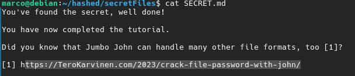

# H3 — Linux and Password Cracking

**Cyber Security · Haaga-Helia · Autumn 2026**  
**Environment:** Debian 13 (Trixie), virtual machine

This report covers Linux command-line basics, installation of a Debian virtual machine, a Hashcat exercise, and an optional John the Ripper Jumbo ZIP-password exercise.

---

## x) Read and Summarize

### Karvinen (2020): Command Line Basics Revisited

- Linux commands such as `pwd`, `ls`, `cd`, `less`, and `nano` make file navigation and editing efficient.
- File operations include `mkdir`, `mv`, `cp`, `rm`, and `rmdir`. Deletions with `rm` require care because there is no recycle bin.
- SSH provides encrypted remote access, while `scp` transfers files securely.
- `man`, `--help`, Tab completion, and command history help users work effectively.
- System configuration is commonly located in `/etc/`, while `/var/log/` contains useful logs. Debian software can be managed using `apt`.
- **My takeaway:** The principle of least privilege is important: `sudo` should be used only when administrative access is actually needed.

[Read the article](https://terokarvinen.com/2020/command-line-basics-revisited/)

### Karvinen (2022): Cracking Passwords with Hashcat

- Systems store password hashes rather than plain-text passwords. Hashing is not reversible like decryption.
- Hashcat tests candidate passwords by comparing their hashes with a target hash.
- `hashid` helps identify possible hash formats; Hashcat's `-m 0` selects MD5.
- The RockYou wordlist contains millions of password candidates and can be used in dictionary attacks.
- Weak, common passwords can be recovered quickly, especially with suitable hardware.
- **My question:** How much slower would this exercise be with a modern password hash such as Argon2id instead of MD5?

[Read the article](https://terokarvinen.com/2022/cracking-passwords-with-hashcat/)

---

## a) Presentation Title in Moodle

**Status:** Not yet confirmed in this report. The presentation title must be reserved in Moodle; this step does not require a computer test report.

---

## b) Linux — Debian 13 (Trixie)

I had already downloaded and installed **Debian 13 (Trixie)** in a virtual machine before completing these password exercises. I used the VM's terminal to install the required tools and run the commands below.

I installed `fastfetch` to display the operating system and hardware details:

```bash
sudo apt update
sudo apt install fastfetch -y
fastfetch
```


*Figure 1. Debian 13 (Trixie) VM and system information shown with Fastfetch.*

---

## c) Crack — Hashcat

**Task:** Crack the practice hash `6b1628b016dff46e6fa35684be6acc96` using Hashcat, following Karvinen (2022).

### Installation and wordlist

```bash
sudo apt update
sudo apt install -y hashid hashcat wget
```

I used a RockYou password dictionary for the exercise. The archive-based download shown in the original tutorial is:

```bash
wget https://github.com/danielmiessler/SecLists/raw/master/Passwords/Leaked-Databases/rockyou.txt.tar.gz
tar xf rockyou.txt.tar.gz
```

### Identifying and cracking the hash

```bash
hashid -m 6b1628b016dff46e6fa35684be6acc96
echo '6b1628b016dff46e6fa35684be6acc96' > hash.txt
hashcat -m 0 -a 0 hash.txt rockyou.txt -o solved
cat solved
```

The exercise uses **MD5** (`-m 0`) and a **dictionary attack** (`-a 0`).

**Result:**

```text
6b1628b016dff46e6fa35684be6acc96:summer
```

The example password was **`summer`**. This demonstrates how easily a common password can be recovered from a fast hash when it appears in the wordlist.

[Source: Karvinen (2022)](https://terokarvinen.com/2022/cracking-passwords-with-hashcat/)

---

## d) Voluntary Bonus — John the Ripper Jumbo

**Task:** Recover the password of the encrypted practice archive `tero.zip` using John the Ripper Jumbo.

### Installing the Jumbo version

The Debian package installed `john`, but **`zip2john` was not available**. I therefore compiled John the Ripper Jumbo from its source code.

```bash
sudo apt update
sudo apt install -y git build-essential libssl-dev zlib1g-dev pkg-config
cd ~
git clone https://github.com/openwall/john.git
cd john/src
./configure
make -j"$(nproc)"
```

### Recovering the ZIP password

In my working directory, I converted the ZIP archive to a John-compatible hash and tested it against the RockYou wordlist:

```bash
cd ~/hashed
~/john/run/zip2john tero.zip > zip.hash
~/john/run/john --wordlist=rockyou.txt zip.hash
~/john/run/john --show zip.hash
```

**Result:** John successfully recovered the password **`butterfly`**.

I extracted the archive, entered the recovered password when prompted, and read its contents:

```bash
unzip tero.zip
cat secretFiles/SECRET.md
```



*Figure 2. `SECRET.md` confirms that the John the Ripper exercise was completed successfully.*

The recovered file displayed *“You've found the secret, well done!”* and confirmed completion of the tutorial.

[Source: Karvinen (2023)](https://terokarvinen.com/2023/crack-file-password-with-john/)

---

## Conclusion

Both password exercises succeeded: **Hashcat recovered `summer`** from the MD5 example, and **John the Ripper Jumbo recovered `butterfly`** from an encrypted ZIP archive. The exercises illustrate why short or common passwords are vulnerable to dictionary attacks. Testing should only be performed on owned or explicitly authorized practice targets.

## References

- Karvinen, T. (2020). [Command Line Basics Revisited](https://terokarvinen.com/2020/command-line-basics-revisited/).
- Karvinen, T. (2022). [Cracking Passwords with Hashcat](https://terokarvinen.com/2022/cracking-passwords-with-hashcat/).
- Karvinen, T. (2023). [Crack File Password With John](https://terokarvinen.com/2023/crack-file-password-with-john/).
