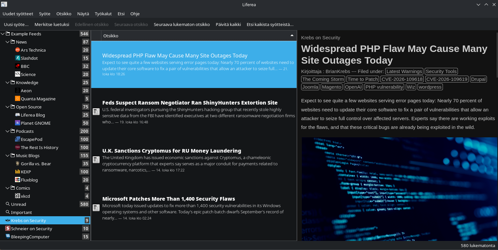
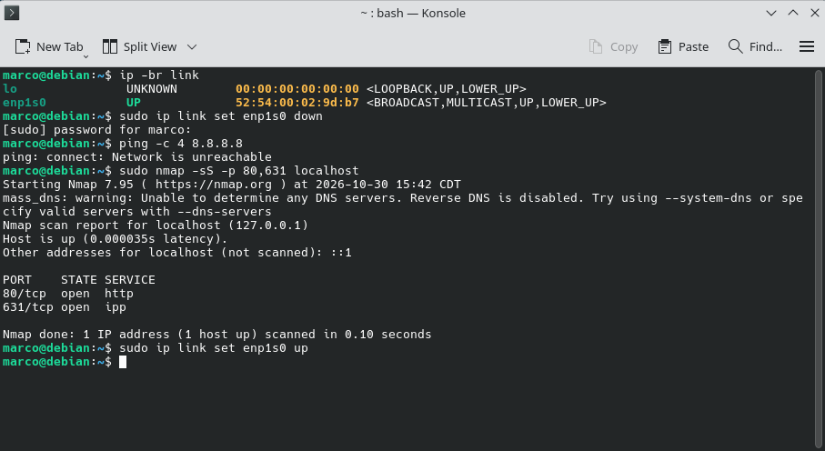
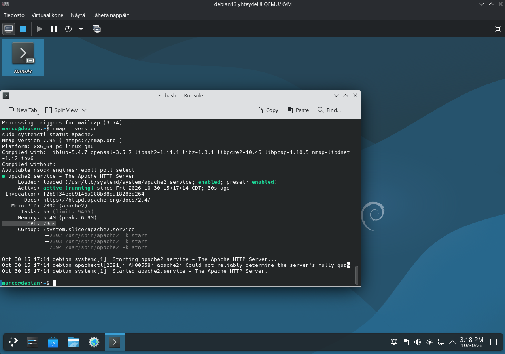
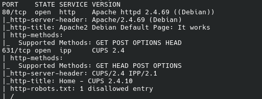
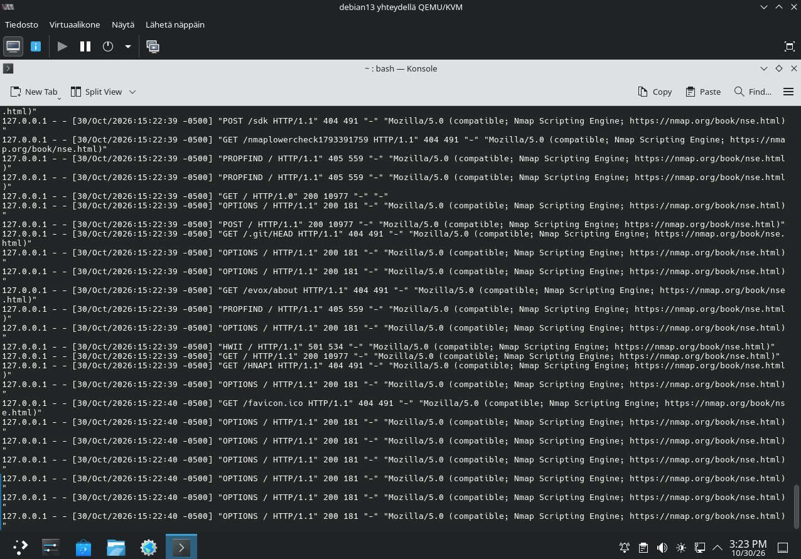
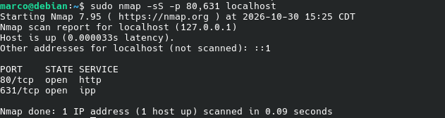
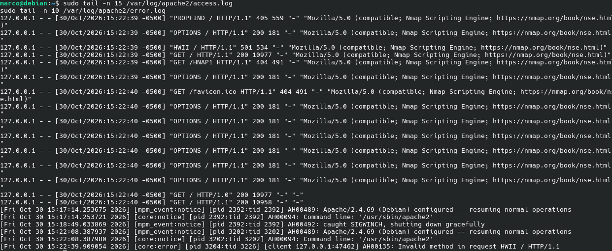

# h4 – Feed Me

**Cyber Security – 2026 | Haaga-Helia**  
**Environment:** CachyOS (RSS reader) and Debian 13 virtual machine (Nmap laboratory)

## x) Why use an RSS/Atom reader?

An RSS reader lets me follow news sites and blogs in one place instead of visiting them separately. I choose the sources myself, without social media algorithms deciding what I should see. It saves time because I can browse headlines and open only the articles that interest me. RSS also makes it easier to keep up with cybersecurity news from Finland and abroad.

## y) KKO:2003:36 – Port scanning and the law

In this Finnish Supreme Court case, a 17-year-old scanned IP addresses belonging to the OP banking group's network in 1998, looking for weaknesses that could be used to break into the system. He did not gain access, but the court found that his actions amounted to **attempted unauthorized access**.

The important lesson is that a port scan **can** be part of a criminal attempt when there is an intention to break into a system. Port scanning is not automatically illegal in every situation. The offender also had to pay **75,000 Finnish marks** in compensation for the costs caused by investigating the incident; his age did not justify reducing the damages in this case.

**Reference:** [KKO:2003:36 (Finlex)](https://finlex.fi/fi/oikeuskaytanto/korkein-oikeus/ennakkopaatokset/2003/36)

## a) Installing an RSS reader

I installed **Liferea**, an open-source RSS reader, on my CachyOS Linux computer.

```bash
sudo pacman -Syu liferea
liferea
```

In Liferea, I used **New Subscription** to add cybersecurity feeds. The screenshot shows Liferea running and displaying articles from Krebs on Security, along with other subscriptions.



## b) Krebs on Security

**Feed:** https://krebsonsecurity.com/feed/

I added Krebs on Security to follow investigations into cybercrime, security incidents and vulnerabilities. The articles often provide more background than short news reports.

## c) Schneier on Security

**Feed:** https://www.schneier.com/feed/atom/

I added Schneier on Security for broader perspectives on security, privacy, technology and society.

## d) Two additional cybersecurity sources

**Finnish National Cyber Security Centre (NCSC-FI).** I chose this source because it provides official information about threats and incidents relevant to Finland. Most of my other sources focus on international news.

**SecurityWeek.** I chose SecurityWeek because it covers enterprise cybersecurity, vulnerabilities and industry developments, often with more analysis than short breaking-news articles.

I also followed **BleepingComputer** for current security news. The Liferea screenshot confirms that this subscription was added.

## e) Benefits and disadvantages of RSS

### Benefits

The biggest advantage is having different cybersecurity sources in one place. BleepingComputer provides quick news, Krebs offers investigations, SecurityWeek focuses on businesses, NCSC-FI covers Finland, and Schneier gives a broader perspective. I can quickly check the headlines without relying on recommendation algorithms.

### Disadvantages

The main problem is information overload. Unread articles can pile up quickly, and different sources sometimes cover the same incident. Most of the feeds are also in English, and not all articles are directly related to technical cybersecurity.

Overall, RSS is a useful way to follow the field, but I need to filter what I read.

## f) Port scanning localhost with Nmap

I used my **Debian 13 virtual machine** for the port-scanning exercises. I installed Nmap 7.95 and Apache HTTP Server.

First, I installed the required software:

```bash
sudo apt update
sudo apt install nmap apache2 -y
nmap --version
```

### Disconnecting from the Internet

Before scanning, I disconnected my virtual machine from the internet using the terminal:

```bash
ip -br link
sudo ip link set enp1s0 down
ping -c 4 8.8.8.8
```

The ping command returned **Network is unreachable**, confirming that the network connection was disabled.

I also verified that localhost could still be scanned without an internet connection:

```bash
sudo nmap -sS -p 80,631 localhost
```

Both ports, **80/tcp** and **631/tcp**, were open during this test.



After the test, I re-enabled the network interface:

```bash
sudo ip link set enp1s0 up
```

### Port Scanning Before and After Starting Apache

I stopped Apache and scanned localhost (`127.0.0.1`):

```bash
sudo systemctl stop apache2
sudo nmap -A -v localhost
```

With Apache stopped, Nmap reported **631/tcp open** (CUPS) and **999 other scanned TCP ports closed**.

Next, I started Apache and repeated the scan:

```bash
sudo systemctl start apache2
sudo nmap -A -v localhost
```

Nmap now identified **80/tcp open** (Apache httpd 2.4.69) and **631/tcp open** (CUPS).

| Port | Before starting Apache | After starting Apache |
|---|---|---|
| 80/tcp – HTTP | Closed | Open – Apache 2.4.69 |
| 631/tcp – IPP | Open – CUPS | Open – CUPS |





### Results

Starting Apache made a new open port visible to Nmap. This shows how running services affect a system's exposed network surface.

The offline test also demonstrated that **localhost can be scanned without an internet connection**. All scans were performed against my own virtual machine.

## g) Detecting the scan in Apache logs (optional)

After running the aggressive Nmap scan, I inspected the web server logs:

```bash
sudo tail -n 30 /var/log/apache2/access.log
sudo tail -n 30 /var/log/apache2/error.log
```

The access log showed many requests from `127.0.0.1`, including `GET`, `POST`, `OPTIONS` and `PROPFIND`. Several included the User-Agent **Nmap Scripting Engine**. The error log also recorded an invalid HTTP method. These entries made Nmap's HTTP probing easy to recognize.



## h) Changing the scanning method (optional)

I compared the previous `-A` scan with a TCP SYN scan that did not run HTTP service-detection scripts:

```bash
sudo nmap -sS -p 80,631 localhost
sudo tail -n 15 /var/log/apache2/access.log
sudo tail -n 10 /var/log/apache2/error.log
```

The SYN scan found **80/tcp** and **631/tcp** open, completing in **0.09 seconds**. The subsequent Apache log check showed no new HTTP entries associated with this scan.





This demonstrates that a SYN scan may avoid the **HTTP application-log detection method** used in part g. It does **not** mean the scan is invisible: firewalls and network monitoring tools can still detect the network traffic.

## Conclusion

In this exercise, I installed an RSS reader to follow cybersecurity news and used Nmap to investigate my own Debian virtual machine. I learned how services affect open ports and how different scanning techniques leave different evidence in application logs.
