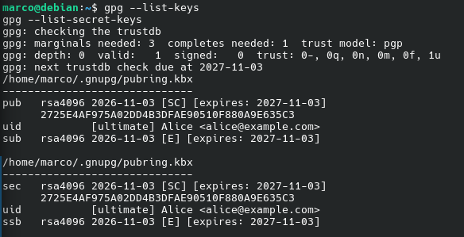
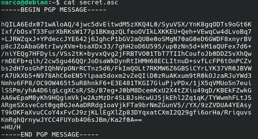
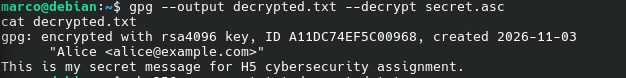
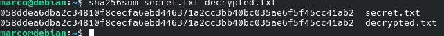
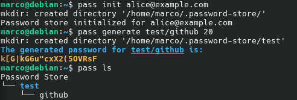
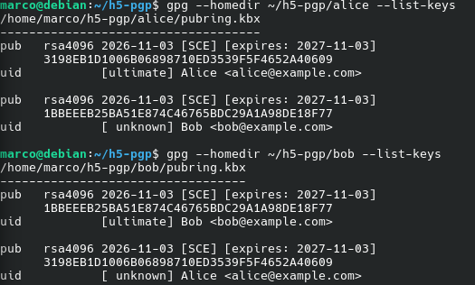
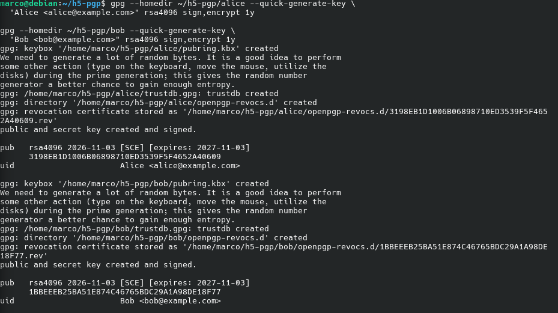
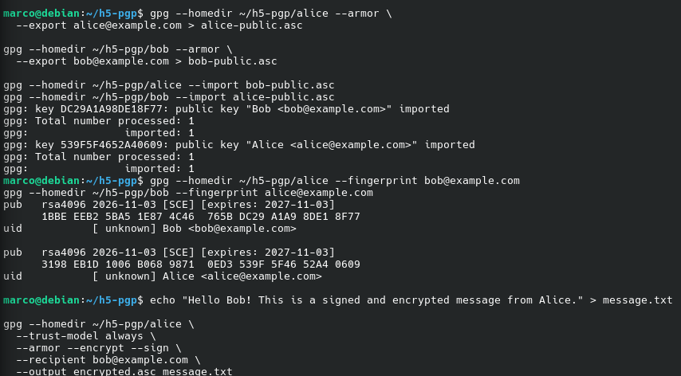
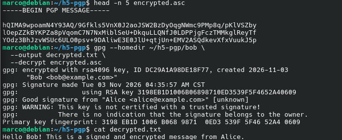

# H5 – Alice and Bob

**Course:** Cyber Security – ICB705AS3YE-2  
**Author:** Marco Brandt  
**Environment:** Debian 13 (Trixie)

## x) Read and summarize

### 1. Schneier (2015) – Applied Cryptography, Chapter 1.1: Terminology

- **Encryption** converts an original message (plaintext) into an unreadable message (ciphertext). Decryption converts it back to the original.
- **Cryptography** protects information. Besides confidentiality, it can also verify the sender, protect data from modification and provide proof of origin.
- **Algorithms and keys:** Modern encryption uses algorithms and keys. The algorithm can be public, but the key must remain secure. Security should not depend on hiding how the algorithm works.
- **Symmetric encryption** uses the same key for encryption and decryption. It can use stream ciphers or block ciphers.
- **Asymmetric encryption** uses two different keys. The public key can be shared with everyone, while the private key must remain secret. A message encrypted with the public key can only be decrypted with the corresponding private key.
- **Keyspace** means all the possible keys an encryption system can use. A cryptosystem includes the algorithm, keys, plaintexts and ciphertexts.

**My thoughts:** I think the most important thing is how the keys are managed. Even a strong encryption algorithm becomes useless if someone gets access to the private key.

### 2. Schneier (2015) – Applied Cryptography, Chapter 2.5: Communications Using Public-Key Cryptography

- **Symmetric encryption** uses the same key to encrypt and decrypt information. The problem is how to share the key securely.
- **Public-key encryption** uses two keys. Anyone can encrypt a message using the public key, but only the person with the private key can decrypt it.
- **Key management** is easier with public-key encryption because Alice can send Bob an encrypted message without sharing a secret key beforehand.
- **Performance:** Public-key encryption is much slower than symmetric encryption. It is also vulnerable to certain attacks if used incorrectly.
- **Hybrid encryption** combines both methods. Public-key encryption is used to exchange a random session key, and symmetric encryption handles the actual messages. This makes communication faster and more practical.
- **Merkle's Puzzles** was an early idea for secure key exchange, where solving one puzzle is easy compared to an attacker having to solve many puzzles.

**My thoughts:** I think hybrid encryption is a good solution because it combines the advantages of both methods. It also shows that using different encryption methods together can be more practical than relying on just one.

### 3. Karvinen (2023) – PGP: Send Encrypted and Signed Message – gpg

- **PGP encryption** allows users to send encrypted messages over the internet. Only the recipient with the correct private key can decrypt the message.
- **Digital signatures** are used to verify who sent the message and that it has not been modified.
- **Public and private keys:** Public keys can be shared with anyone, but private keys must be kept secret. Key fingerprints should be verified to make sure the public key belongs to the correct person.
- **GPG** is a command-line tool for encrypting, signing and decrypting messages. Users first generate their own key pairs and exchange public keys.
- **Sending messages:** The sender encrypts the message with the recipient's public key and signs it with their own private key.
- **Receiving messages:** The recipient decrypts the message with their private key and verifies the signature using the sender's public key.

**My thoughts:** I think PGP is a good example of how encryption and digital signatures work together. The commands are quite simple, but managing and verifying the keys correctly is important for security.

## a) Pubkey today – HTTPS and GitHub

I use GitHub to publish my cybersecurity course assignments. When I open GitHub in Firefox using HTTPS, public-key cryptography helps secure the connection.

- GitHub provides a TLS certificate containing its public key.
- Firefox checks the certificate to verify that it is communicating with the correct server.
- GitHub uses its private key to prove its identity during the TLS handshake.
- The browser and server establish shared session keys using a secure key exchange.
- Symmetric encryption protects the actual data transferred between Firefox and GitHub.

> **My thoughts:** I think this is very useful because I can log in to GitHub once and stay logged in without entering my password every time I upload files or check my repositories. Public-key cryptography helps protect my connection and data, while session cookies allow GitHub to remember my login. This makes using GitHub both easier and more secure.

## b) Encrypt a message – GPG

I tested encryption and decryption on my Debian 13 virtual machine using GNU Privacy Guard (GPG).

### Generate and inspect keys

I generated a 4096-bit RSA key pair for `Alice <alice@example.com>` and checked that both the public and private keys existed. The keys were created on November 3, 2026 and expire on November 3, 2027.

```bash
gpg --full-generate-key
gpg --list-keys
gpg --list-secret-keys
```



### Encrypt a message

I created a short text file and encrypted it using Alice's public key.

```bash
echo "This is my secret message for H5 cybersecurity assignment." > secret.txt
gpg --armor --encrypt --recipient alice@example.com --output secret.asc secret.txt
cat secret.asc
```

The result was an ASCII-armored encrypted PGP message, which was not readable as ordinary text.



### Decrypt and verify

I decrypted the file using the corresponding private key.

```bash
gpg --output decrypted.txt --decrypt secret.asc
cat decrypted.txt
sha256sum secret.txt decrypted.txt
```

The decrypted message was:

```text
This is my secret message for H5 cybersecurity assignment.
```



The SHA-256 hashes of `secret.txt` and `decrypted.txt` matched, confirming that the decrypted file contained exactly the same bytes as the original.



### How different parties use keys

GPG uses public-key cryptography. Each user has two keys:

- **Public key:** Used for encryption and verifying digital signatures.
- **Private key:** Used for decryption and creating digital signatures.

| Action | User | Key |
|---|---|---|
| Encryption | Sender | Recipient's public key |
| Signing | Sender | Own private key |
| Decryption | Recipient | Own private key |
| Signature verification | Recipient | Sender's public key |

The private key must never be shared, but the public key can be shared with anyone. Its authenticity still needs to be verified.

In my test, I used Alice's public key to encrypt the message and her private key to decrypt it. In normal communication between two people, the sender would encrypt the message using the recipient's public key. GPG normally uses hybrid encryption: the public-key algorithm protects a session key, and a symmetric algorithm encrypts the message data.

### Security evaluation of GPG

**Strengths:** GPG is an established open-source encryption tool. It supports strong algorithms such as RSA-4096 and AES-256. It can protect messages over untrusted networks when used correctly.

**Weaknesses:** GPG can be difficult to use correctly. Security depends on keeping private keys safe and verifying public keys. Traditional PGP message encryption does not provide forward secrecy, so a stolen private key may expose previously recorded encrypted messages.

**My thoughts:** I think GPG provides strong security when used correctly. The biggest risk is probably the user making a mistake, not the encryption algorithm itself. Even strong encryption is useless if someone gets access to the private key.

## c) Eve and Mallory

- **Eve (eavesdropper)** tries to read messages without permission. PGP protects against this using encryption (`--encrypt --recipient`). The sender encrypts a message for the recipient using their public key, and the recipient decrypts it with their private key.
- **Mallory (message modifier)** tries to change messages or pretend to be the sender. PGP uses digital signatures (`--sign`) to detect modifications. The sender signs with their private key, and the recipient verifies the signature using the sender's public key. Changing the signed message makes verification fail.

**My thoughts:** Encryption keeps a message private, while digital signatures help verify who sent it and whether it was modified. Both are important for secure communication. A signature is only meaningful as proof of identity if the recipient has verified that the public key belongs to the correct sender.

## d) Password management

### Why use a password manager?

A password manager keeps passwords in encrypted storage, so users do not have to remember a different password for every service. For example, `pass` uses GPG to encrypt stored passwords and can generate random passwords.

Without a password manager, people may reuse passwords, choose easy passwords or store them insecurely. Unique, strong passwords reduce several risks:

| Attack | How a password manager helps |
|---|---|
| Credential stuffing | A leaked password from one service cannot be reused to log into a different service if passwords are unique. |
| Password spraying | Strong random passwords are less likely to match commonly guessed passwords. |
| Phishing | Unique passwords can limit damage across accounts, but a password manager does **not** prevent all phishing attacks. |
| Brute-force attacks | Long random passwords are harder to guess or crack. |

### Practical test with `pass` on Debian 13

I tested the `pass` password manager using the GPG key created earlier in this assignment. I initialized the password store, generated a 20-character test password and listed the saved entries.

```bash
sudo apt install pass -y
pass init alice@example.com
pass generate test/github 20
pass ls
```

The `pass ls` output showed the entry `test/github`, confirming that the password had been saved. I did not use this test password for a real account.



**My thoughts:** I think password managers are useful because remembering different passwords for every service is difficult. Strong and unique passwords make it harder for attackers to access several accounts after one password has leaked.

## e) Refer to sources

Done. I reviewed the source references for H0–H5 and added relevant references where needed.


## f) Details of PGP – Encrypted and Signed Message

I tested encrypted and signed PGP communication on my Debian 13 virtual machine using GPG. I simulated two users, Alice and Bob, by creating separate GPG directories for both of them.

### Creating the key pairs

First, I created separate RSA 4096-bit key pairs for Alice and Bob.

```bash
gpg --homedir ~/h5-pgp/alice --quick-generate-key \
  "Alice <alice@example.com>" rsa4096 sign,encrypt 1y

gpg --homedir ~/h5-pgp/bob --quick-generate-key \
  "Bob <bob@example.com>" rsa4096 sign,encrypt 1y
```

Both users now had their own public and private keys.



### Checking the keys

I checked the keys using:

```bash
gpg --homedir ~/h5-pgp/alice --list-keys
gpg --homedir ~/h5-pgp/bob --list-keys
```

The keyrings showed the users' own keys and, after importing, the other user's public key.



### Exchanging public keys

Next, I exported the public keys and imported them into the other user's keyring.

```bash
gpg --homedir ~/h5-pgp/alice --armor \
  --export alice@example.com > alice-public.asc

gpg --homedir ~/h5-pgp/bob --armor \
  --export bob@example.com > bob-public.asc

gpg --homedir ~/h5-pgp/alice --import bob-public.asc
gpg --homedir ~/h5-pgp/bob --import alice-public.asc
```

I also checked the fingerprints to identify the public keys.

```bash
gpg --homedir ~/h5-pgp/alice --fingerprint bob@example.com
gpg --homedir ~/h5-pgp/bob --fingerprint alice@example.com
```

The public keys can be shared, but private keys must remain secret.

### Encrypting and signing the message

Alice created a message for Bob:

```bash
echo "Hello Bob! This is a signed and encrypted message from Alice." > message.txt
```

She encrypted the message using Bob's public key and signed it using her own private key.

```bash
gpg --homedir ~/h5-pgp/alice \
  --trust-model always \
  --armor --encrypt --sign \
  --recipient bob@example.com \
  --output encrypted.asc message.txt
```

The `--encrypt` option encrypts the message, while `--sign` adds Alice's digital signature.

The `--trust-model always` option was used for this local test. It bypasses GPG's normal public-key trust checks, so it should not replace proper key verification in real communication.

I checked the encrypted file:

```bash
head -n 5 encrypted.asc
```

The file started with:

```text
-----BEGIN PGP MESSAGE-----
```

The original message was no longer readable.



### Decrypting and verifying the signature

Bob decrypted the message using his private key:

```bash
gpg --homedir ~/h5-pgp/bob \
  --output decrypted.txt \
  --decrypt encrypted.asc
```

GPG reported:

```text
gpg: Good signature from "Alice <alice@example.com>" [unknown]
```

This confirmed that the signature matched Alice's public key and that the signed message had not been modified.

GPG also displayed a warning that Alice's key was not certified with a trusted signature. This does not mean the signature was invalid. It means the identity behind the public key had not been fully verified through GPG's trust system.

I checked the decrypted message:

```bash
cat decrypted.txt
```

The original message appeared:

```text
Hello Bob! This is a signed and encrypted message from Alice.
```



### Results

The test was successful.

- Alice encrypted the message using Bob's public key.
- Alice signed the message using her private key.
- Bob decrypted the message using his private key.
- Bob verified the signature using Alice's public key.
- GPG reported a valid signature and the original message was recovered.

Encryption protects the message from being read by outsiders, while digital signatures help verify its origin and integrity.

### How can Bob decrypt the message without sharing his private key?

This was the most interesting part of the exercise for me.

Bob does not need to share his private key with Alice. This is the basic idea of asymmetric encryption.

**1. Bob creates two keys:**

- **Public key:** Bob shares this with Alice and anyone else.
- **Private key:** Bob keeps this secret.

**2. Alice encrypts the message using Bob's public key.**

The encryption algorithm makes sure that only the corresponding private key can recover the information needed to decrypt the message.

**3. Bob decrypts the message using his private key.**

The two keys are mathematically connected, so they work together. Alice never needs to know Bob's private key.

**4. Bob verifies Alice's signature using her public key.**

This confirms that the message was signed with Alice's private key and has not been modified. Bob must also verify that the public key really belongs to Alice.

### A simple example

Imagine Bob gives everyone an open padlock but keeps the only key for himself.

- Alice puts her message in a box and locks it using Bob's padlock.
- Alice sends the locked box to Bob.
- Only Bob has the key to open the box and read the message.

Anyone can lock a message for Bob, but only Bob can unlock it.

### How GPG actually works

GPG uses **hybrid encryption**.

The message itself is encrypted using a random symmetric session key. This session key is then encrypted using Bob's public key.

When Bob receives the message, he uses his private key to recover the session key, which is then used to decrypt the actual message.

### My thoughts

The interesting part is that Bob never needs to share his private key with anyone. Alice can send him a secure message using only his public key.

I think this is a good example of why public-key encryption is useful. Encryption protects the message, while digital signatures help verify who sent it and whether it was modified. Both are important for secure communication.

## References

1. Schneier, B. (2015). *Applied Cryptography: Protocols, Algorithms, and Source Code in C*. 20th Anniversary Edition. Wiley. Chapters 1.1 and 2.5. https://learning.oreilly.com/library/view/applied-cryptography-protocols/9781119096726/
2. Karvinen, T. (2023). *PGP – Send Encrypted and Signed Message – gpg*. https://terokarvinen.com/2023/pgp-encrypt-sign-verify/
3. Karvinen, T. (2026). *Cyber Security – ICB705AS3YE-2*, H5 Alice and Bob. https://terokarvinen.com/cyber-security/#h5-alice-and-bob
4. IETF (2018). RFC 8446: *The Transport Layer Security (TLS) Protocol Version 1.3*. https://www.rfc-editor.org/rfc/rfc8446
5. GnuPG Project. *The GNU Privacy Guard Documentation*. https://gnupg.org/documentation/
6. passwordstore.org. *pass – the standard unix password manager*. https://www.passwordstore.org/
