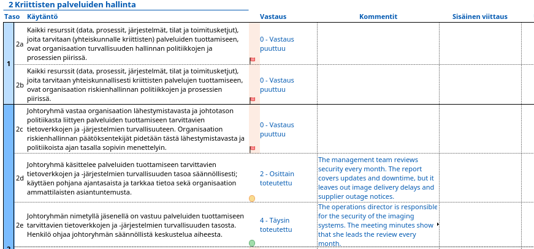

# H6 Mature

## x) Reading and summary

- **Assessment process (p. 10).** Management starts the assessment and appoints a sponsor and a facilitator. They define the scope, identify critical dependencies and involve people who know how the service works. The group assesses current practices, sets a target, prioritises improvements and revisits the assessment after making changes.
- **Maturity model (pp. 11–14).** Cybermeter groups practices into objectives across 11 domains. Maturity ranges from 0 to 3. At level 0, the basic requirements are unmet. At level 1, basic practices are in place but may be ad hoc. Level 2 adds documented processes and clear responsibilities. Level 3 adds policy direction, performance monitoring and continuous improvement.
- **Scoring (section 3.3, pp. 13–14).** The workbook counts a practice as implemented when its answer is 3 (mostly implemented) or 4 (fully implemented). An objective reaches level 1 when all its level 1 practices are implemented. For level 2, it needs all level 1 practices and more than half of the level 2 practices. For level 3, it needs all level 1 and 2 practices and more than half of the level 3 practices. The lowest-scoring objective determines the domain’s maturity level. [Traficom, *Cybermeter User Guide*, section 3.3.](https://terokarvinen.com/kybermittari/files/Kybermittari_Cybermeter_User_Guide_V1.pdf#page=14)
- **Maturity report (p. 23).** The report shows a chart of the 11 domains and a breakdown by objective. The breakdown helps the team see which objective is holding a domain back. [Traficom, *Cybermeter User Guide*.](https://terokarvinen.com/kybermittari/files/Kybermittari_Cybermeter_User_Guide_V1.pdf)
- **Spreadsheet overview.** The **Summary** tab shows how many practices have been answered in each domain. The domain tabs are where I can record answers, comments and evidence. **R2** shows the maturity results by domain and objective. [Traficom, *Kybermittari assessment workbook v2.1*.](https://terokarvinen.com/kybermittari/files/Kybermittarin%20arviointity%C3%B6kalu_v2.1_20230829.xlsx)

## a) Make-believe analysis

I chose **CRITICAL 2d and 2e** from Cybermeter. My example is a fictional eye clinic where the imaging server was up, but the retinal images did not reach the doctor during the appointment. I wanted to see what the management team hears about incidents like this and who is responsible for the security of the imaging systems.

**Mika, cybersecurity specialist:** “We go over security with the management team every month. I report on updates and downtime. I’d put ‘mostly implemented’ for 2d.”

**Aino, lead imaging nurse:** “Did the report include what happened last Tuesday? The server was up, but the doctor only got the images after the patient had left.”

**Leo, supplier manager:** “I also got two outage notices from the equipment supplier. They stayed in my inbox. I can send Mika a summary before the next meeting.”

**Sari, operations director:** “Let’s put **2 – Partially implemented** for 2d. We have a monthly review, but the report leaves out how these incidents affect appointments. For 2e, I’d put **4 – Fully implemented**. The management team’s decision names me as the member accountable for the security of the networks and systems that support imaging. The meeting minutes show that I lead the review every month.”

We agreed that Mika would add image delivery delays and supplier outage notices to the next report. After two reviews, the group would check the minutes to see if management had acted on the new information.

*Figure 1. The two practice ratings in Traficom’s Cybermeter v2.1 workbook (CC BY 4.0). Only CRITICAL 2d and 2e were assessed, so there is no overall maturity rating for the domain in this exercise.*

## b) Sucks or succeeds

**Sucks.** Kybermittari would be useless if one person from IT filled it in just to get it done. In my eye clinic example, IT could look at the uptime report and assume everything was fine. The imaging nurse knew that the doctor got the images after the patient had already left. If nobody asks the nurse what happened and the report just gets filed away, the same problem can happen at the next appointment.

**Succeeds.** I would put IT, imaging staff, the supplier manager and the operations director in the same meeting. IT can show when the server was up, the nurse can explain what happened during the appointment, and the supplier manager can bring the outage notices. The operations director can ask Mika to include image delivery delays and supplier outages in the next monthly report. After two reviews, the group can check whether those figures led to a decision and whether fewer images arrived late.

## c) Competition

**NIST Cybersecurity Framework (CSF) 2.0.** I could use a Current Profile to describe what the eye clinic does today and a Target Profile to describe what I want to improve. For example, the current report shows server uptime, and the target is for management to also see how often images arrive too late for appointments. The benefit is that I can set targets around the problems that matter to the clinic. The downside is that I would need to decide what evidence is enough to show that the clinic has reached each target. Kybermittari provides specific questions and scoring rules for assessing maturity. [NIST, *Quick-Start Guide for Creating and Using Organizational Profiles*.](https://csrc.nist.gov/pubs/sp/1301/final)

**CIS Controls v8.1.** I could start with Implementation Group 1 (IG1), which gives the IT team a prioritised list of basic safeguards. For example, the clinic could check whether its imaging workstations and devices are included in the asset inventory. The benefit is that the team gets concrete tasks it can start working on. The downside is that I would still need to check the meeting minutes and reports to assess how well management oversees the security of the imaging service. [CIS, *Implementation Groups*.](https://www.cisecurity.org/controls/implementation-groups) [CIS Control 1, *Inventory and Control of Enterprise Assets*.](https://www.cisecurity.org/controls/inventory-and-control-of-enterprise-assets)

One reason I would choose Kybermittari for a Finnish clinic is that it uses the same scoring method across organisations. If sector figures are available, the clinic can compare its results with its sector’s average and with its own earlier assessments. [Traficom, *Cybermeter User Guide*, pp. 9 and 21.](https://terokarvinen.com/kybermittari/files/Kybermittari_Cybermeter_User_Guide_V1.pdf)

## References

- Karvinen, T. (2026). [*Cyber Security – h6 Mature*](https://terokarvinen.com/cyber-security/#h6-mature). Course assignment.
- Traficom, National Cyber Security Centre Finland. (n.d.). [*Cybermeter User Guide*](https://terokarvinen.com/kybermittari/files/Kybermittari_Cybermeter_User_Guide_V1.pdf). Version 1.0, pp. 9–14, 21 and 23.
- Traficom, National Cyber Security Centre Finland. (2023, August 29). [*Kybermittari assessment workbook*](https://terokarvinen.com/kybermittari/files/Kybermittarin%20arviointity%C3%B6kalu_v2.1_20230829.xlsx). Version 2.1. Source workbook for Figure 1.
- National Institute of Standards and Technology. (2024). [*NIST Cybersecurity Framework 2.0: Quick-Start Guide for Creating and Using Organizational Profiles*](https://doi.org/10.6028/NIST.SP.1301). NIST SP 1301.
- Center for Internet Security. (n.d.). [*CIS Critical Security Controls Implementation Groups*](https://www.cisecurity.org/controls/implementation-groups).
- Center for Internet Security. (n.d.). [*CIS Critical Security Control 1: Inventory and Control of Enterprise Assets*](https://www.cisecurity.org/controls/inventory-and-control-of-enterprise-assets).
