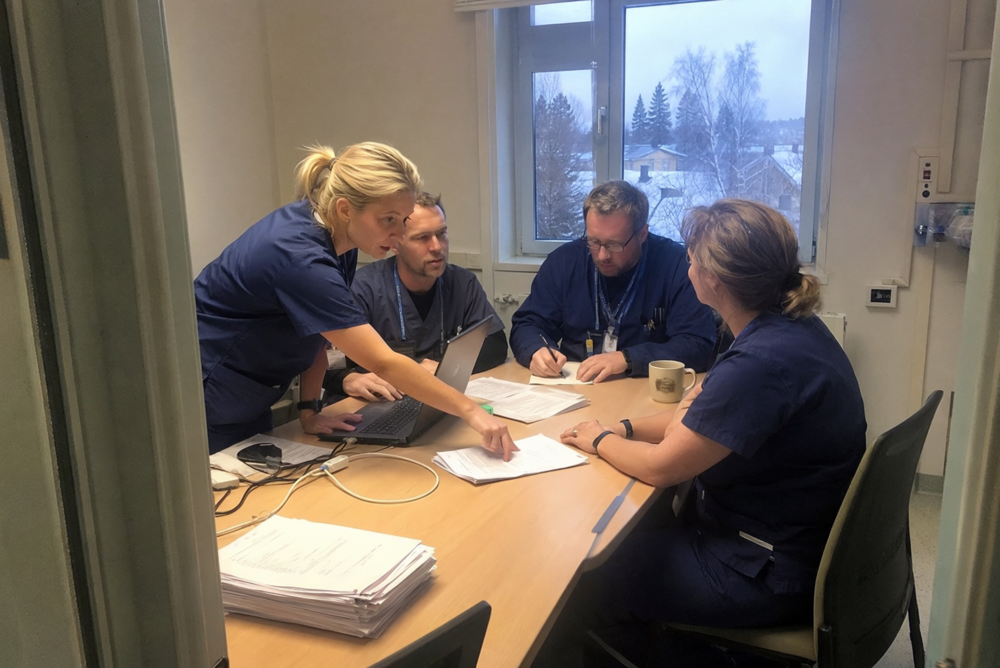

# H7 — SecuDream™ – Cyber Crisis Leadership

*From First Alert to Lessons Learned*

## a) My dream cybersecurity course

I would take a course where I get to lead a cyber crisis in a simulated hospital. The scenario starts when the imaging worklist and image archive become unavailable. Urgent examinations are waiting, and the cause is unclear. Over five sessions, the same crisis develops from the first alert through recovery and a post-incident review.

*Figure 1. The crisis team assesses an imaging outage during the first-hour exercise. AI-generated illustration.*

### Learning goals

After the course, the student can do the following.

1. **Lead a crisis response under uncertainty** by assigning responsibilities, setting priorities, and documenting decisions as the situation evolves.
2. **Communicate during a cyber crisis** by explaining what is known, what remains uncertain, and what staff and other stakeholders need to do.
3. **Coordinate continuity and recovery** by deciding which services to restore first and how to verify that they can be used safely.

### Agenda and exercises

Students take on roles in the hospital crisis team, including crisis lead, IT lead, clinical representative, and communications lead. The facilitator introduces new information as the incident develops. Decisions made in one session affect what happens in the next.

| Session | Theme | Exercise |
| --- | --- | --- |
| 1 | **The First Hour** | **Tabletop exercise.** The imaging worklist and image archive become unavailable. The students decide when to activate the crisis team, assign responsibilities, and record their first decisions. |
| 2 | **Leading Under Uncertainty** | **Roleplay.** The cause is still unknown, and the emergency department needs urgent imaging. The team decides how to continue urgent examinations and records who made each decision, on what grounds, and when it should be reviewed. |
| 3 | **Crisis Communication** | **Writing exercise and simulated briefing.** Students write an operational update for hospital staff and brief senior management. They explain what is confirmed, what remains uncertain, what staff should do, and when the next update will come. |
| 4 | **Continuity and Safe Recovery** | **Group exercise.** The image archive is back online, but some examinations performed during the outage are missing from it. The team decides which clinical workflows can resume, what checks are required, and who authorizes the return to normal operations. |
| 5 | **Post-Incident Review** | **Facilitated debrief.** Students reconstruct the incident using their decision log and examine which decisions helped or delayed the response. They agree on three improvements and assign an owner and a deadline to each. |

*Figure 2. The team reconstructs the incident timeline during the post-incident review. AI-generated illustration.*

### Models and frameworks

- **NIST SP 800-61 Rev. 3.** Students use NIST’s incident response guidance to structure the hospital’s response and recovery. The decision log captures what the team knew at the time, who made each decision, and when it should be reviewed. [NIST incident response guidance](https://doi.org/10.6028/NIST.SP.800-61r3)
- **WHO After Action Review (AAR).** The final session uses this method to guide a discussion of what happened, what worked, what caused delays, and why. Students use the discussion to agree on specific improvements. [WHO After Action Review](https://www.who.int/publications/i/item/WHO-WHE-CPI-2019.4)

### Guest speakers, excursion, and special event

- **Guest speakers.** A hospital crisis leader and a clinician walk students through how they would prioritize urgent examinations during an imaging outage. A crisis communications specialist plays a journalist in a simulated press briefing and asks what the hospital knows about the outage and its impact on patients.
- **Hospital visit.** Students visit a hospital simulation centre and follow an urgent imaging request from the emergency department to the radiologist using downtime procedures. They use what they learned to decide which services to restore first in the course simulation.
- **Follow-up exercise.** A few weeks after the debrief, students take part in a surprise exercise that tests one of the agreed improvements. For example, if the team assigned responsibility for staff updates, the exercise tests what happens when that person is unavailable.

### Why I would take this course

I work with hospital imaging systems, where a technical outage can quickly affect patient care. I want to practise leading the response before the cause is known, communicating clearly as the situation changes, and deciding with clinical staff when a service is safe to use again. I would also like to test whether a change agreed on during the debrief works under pressure.

## References

- Karvinen, T. (2026). [*Cyber Security – h7 SecuDream*](https://terokarvinen.com/cyber-security/#h7-secudream). Course assignment.
- Nelson, A., Rekhi, S., Souppaya, M., & Scarfone, K. (2025). [*Incident Response Recommendations and Considerations for Cybersecurity Risk Management: A CSF 2.0 Community Profile*](https://doi.org/10.6028/NIST.SP.800-61r3). NIST SP 800-61 Rev. 3.
- World Health Organization. (2019). [*Guidance for after action review (AAR)*](https://www.who.int/publications/i/item/WHO-WHE-CPI-2019.4). WHO/WHE/CPI/2019.4.
