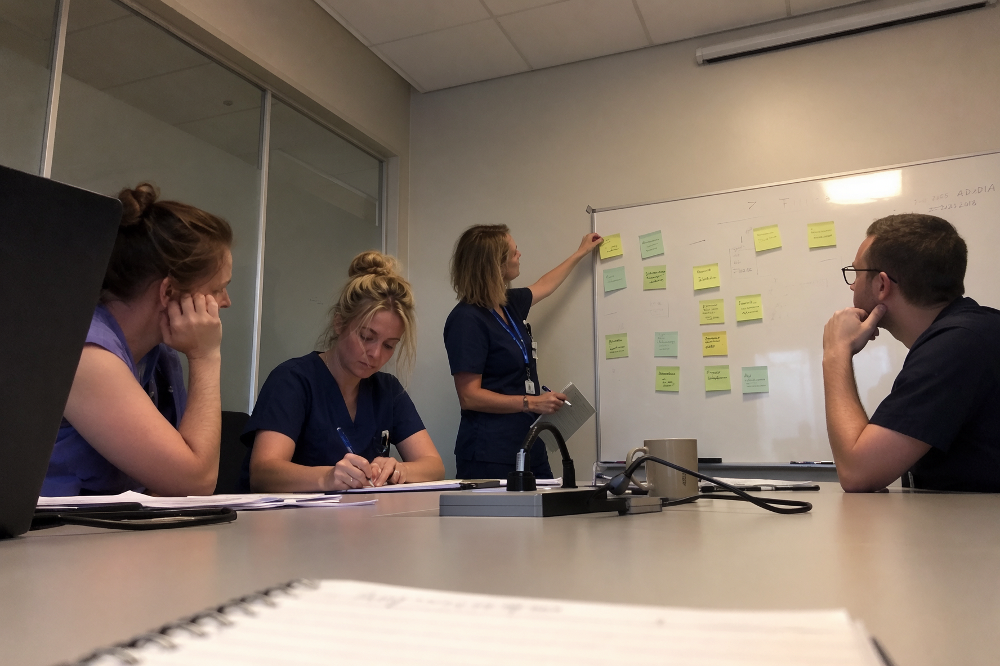

# H7 — SecuDream™ – Cyber Crisis Leadership

*From First Alert to Lessons Learned*

## a) My dream cybersecurity course

I would take a course where I get to lead a cyber crisis in a simulated hospital. The scenario starts when the imaging worklist and image archive become unavailable. Urgent examinations are waiting, and the cause is unclear. Over five sessions, the same crisis develops from the first alert through recovery and a post-incident review.

*Figure 1. The crisis team assesses an imaging outage during the first-hour exercise. AI-generated illustration.*

### Learning goals

After the course, the student can do the following.

1. **Lead a crisis response under uncertainty** by assigning responsibilities, setting priorities, and documenting decisions as the situation evolves.
2. **Communicate during a cyber crisis** by explaining what is known, what remains uncertain, and what staff and other stakeholders need to do.
3. **Coordinate continuity and recovery** by deciding which services to restore first and how to verify that they can be used safely.

### Agenda and exercises

Students take on roles in the hospital crisis team, including crisis lead, IT lead, clinical representative, and communications lead. The facilitator introduces new information as the incident develops. Decisions made in one session affect what happens in the next.

| Session | Theme | Exercise |
| --- | --- | --- |
| 1 | **The First Hour** | **Tabletop exercise.** The imaging worklist and image archive become unavailable. The students decide when to activate the crisis team, assign responsibilities, and record their first decisions. |
| 2 | **Leading Under Uncertainty** | **Roleplay.** The cause is still unknown, and the emergency department needs urgent imaging. The team decides how to continue urgent examinations and records who made each decision, on what grounds, and when it should be reviewed. |
| 3 | **Crisis Communication** | **Writing exercise and simulated briefing.** Students write an operational update for hospital staff and brief senior management. They explain what is confirmed, what remains uncertain, what staff should do, and when the next update will come. |
| 4 | **Continuity and Safe Recovery** | **Group exercise.** The image archive is back online, but some examinations performed during the outage are missing from it. The team decides which clinical workflows can resume, what checks are required, and who authorizes the return to normal operations. |
| 5 | **Post-Incident Review** | **Facilitated debrief.** Students reconstruct the incident using their decision log and examine which decisions helped or delayed the response. They agree on three improvements and assign an owner and a deadline to each. |

*Figure 2. The team reconstructs the incident timeline during the post-incident review. AI-generated illustration.*

### Detailed Example: The First 60 Minutes

The first session begins with a simulated ransomware incident affecting a hospital's imaging systems. The imaging worklist is unavailable, and clinicians cannot reliably access previously stored images. The hospital must continue providing urgent patient care while the technical cause remains uncertain.

The students form a crisis management team. Each participant receives a role card outlining their responsibilities, decision-making authority, and reporting lines. The facilitator introduces new information throughout the exercise using prepared inject cards.

**Pre-simulation orientation (15 min):** Participants review their role cards, the decision log template, and the principles of crisis communication. The facilitator explains the exercise objectives and assessment criteria.

| Time | Situation | Expected response |
| --- | --- | --- |
| 00–10 min | Imaging workstations report connection failures. | Verify the incident, assess clinical impact, and assign responsibilities. |
| 10–20 min | IT detects suspicious activity on an imaging server. | Escalate the incident, consider containment, and involve cybersecurity specialists. |
| 20–30 min | Emergency patients are waiting for examinations. A suspected stroke patient requires urgent imaging. | Coordinate downtime procedures with clinical staff and prioritize urgent care. |
| 30–45 min | A suspected ransomware message appears. | Review containment decisions, preserve evidence, and prepare internal communications. |
| 45–60 min | Management requests an update and recovery estimate. | Present confirmed facts, uncertainties, immediate priorities, and the next reporting time. |

The objective is not to solve every technical problem within one hour. Instead, students must demonstrate leadership, maintain situational awareness, and make defensible decisions under pressure.

#### Roles

Each participant receives a role card. Example roles include:

- **Crisis lead:** Overall coordination, decision-making authority, and external communication approval.
- **IT lead:** Technical assessment, containment decisions, and coordination with cybersecurity specialists.
- **Clinical lead:** Patient safety, clinical prioritization, and downtime procedure coordination.
- **Communications lead:** Internal and external messaging, including staff, management, and patient communication.
- **Data protection officer:** Advises on GDPR obligations, patient confidentiality, personal data breach assessment, and regulatory notification requirements.
- **Management representative:** Operational impact assessment and approval of resource decisions.

#### Decision Log and Accountability

Each team maintains a decision log throughout the simulation. A designated scribe records entries in real time. The log is maintained electronically when secure systems are available; a paper-based backup is used if digital systems are unavailable or potentially compromised.

| Time | Decision | Reason | Responsible role | Review trigger |
| --- | --- | --- | --- | --- |
| 10:15 | Activate the crisis team | Multiple imaging services are unavailable | Crisis lead | Initial impact assessment |
| 10:25 | Isolate the affected server after assessing dependencies | Suspicious activity may indicate compromise | IT lead | Containment verification |
| 10:35 | Activate clinical downtime procedures | Urgent examinations cannot wait | Clinical lead | Service availability changes |

These entries are examples. During the exercise, students record their actual decisions and explain the information available at the time. The "review trigger" identifies the event or new information that requires reassessment.

#### Crisis Communication Exercise

Students prepare three short communications for different audiences. Each must distinguish confirmed facts from assumptions, avoid speculation about the cause, and identify when the next update will be provided.

1. **Hospital staff:** Explain which services are affected, which downtime procedures apply, and where to report problems.
2. **Hospital management:** Summarize operational impact, confirmed findings, unresolved risks, and decisions requiring management approval.
3. **Patients:** Provide a clear explanation of possible delays without speculating about the cause or exposing confidential information.

**Assessment criteria for communication:**

- Confirmed facts are clearly separated from assumptions.
- The audience receives actionable information appropriate to their role.
- Confidential information is not exposed.
- The next update time is stated.
- The tone is accurate, calm, and understandable.

#### Recovery Priorities

The crisis team agrees on a recovery sequence based on patient safety, clinical dependencies, and technical verification, documenting and justifying the sequence.

Before restoring affected systems, the team must verify the integrity of backups, assess whether the threat has been contained, and ensure that restored systems are not immediately exposed to reinfection.

Restoring a server does not automatically mean that the clinical service is safe to use. Students consider image availability, data integrity, worklist functionality, missing examinations, and reconciliation of studies performed during downtime.

Clinical and technical representatives jointly verify that the affected workflow is safe before normal operations resume.

**Task:** Prepare a written recovery sequence with justifications based on patient safety, clinical dependencies, and technical verification. Identify who must approve the return to normal operations.

#### Learning Assessment and After-Action Review

The facilitator evaluates the team's performance using five criteria. Each is assessed from 0 to 3: not demonstrated, partially demonstrated, adequately demonstrated, or clearly demonstrated.

| Criterion | Evidence of successful performance | Example of "clearly demonstrated" |
| --- | --- | --- |
| Leadership | Responsibilities and decision-making authority are clearly assigned. | The crisis lead assigns roles, confirms authority, and adjusts leadership as the situation evolves. |
| Situational awareness | Confirmed facts and uncertainties are documented separately. | The team maintains a live situation picture and explicitly states what is unknown. |
| Communication | Updates are accurate, understandable, and delivered to the appropriate audience. | Messages separate facts from assumptions and state the next update time. |
| Continuity and recovery | Patient safety and technical dependencies guide recovery decisions. | The recovery sequence is justified by clinical need and jointly verified by clinical and technical leads. |
| Documentation | Decisions, reasoning, responsibilities, and follow-up actions are recorded. | The decision log is complete, timely, and includes review triggers. |

The maximum score is 15 points. The facilitator provides both a numerical score and written feedback. The score supports learning rather than serving as the sole measure of successful crisis management.

During the final debrief, students compare their decisions with the information available at each stage. They identify three concrete improvements, assign responsible persons, and define deadlines. The follow-up exercise tests whether at least one of these improvements works in practice.

**Key takeaway:** Successful cyber crisis management is not only about restoring technology. It is also about protecting patients, coordinating people, communicating uncertainty, and learning from the incident.

### Models and frameworks

- **NIST SP 800-61 Rev. 3.** Students use NIST’s incident response guidance to structure the hospital’s response and recovery. The decision log captures what the team knew at the time, who made each decision, and when it should be reviewed. [NIST incident response guidance](https://doi.org/10.6028/NIST.SP.800-61r3)
- **WHO After Action Review (AAR).** The final session uses this method to guide a discussion of what happened, what worked, what caused delays, and why. Students use the discussion to agree on specific improvements. [WHO After Action Review](https://www.who.int/publications/i/item/WHO-WHE-CPI-2019.4)

### Guest speakers, excursion, and special event

- **Guest speakers.** A hospital crisis leader and a clinician walk students through how they would prioritize urgent examinations during an imaging outage. A crisis communications specialist plays a journalist in a simulated press briefing and asks what the hospital knows about the outage and its impact on patients.
- **Hospital visit.** Students visit a hospital simulation centre and follow an urgent imaging request from the emergency department to the radiologist using downtime procedures. They use what they learned to decide which services to restore first in the course simulation.
- **Follow-up exercise.** A few weeks after the debrief, students take part in a surprise exercise that tests one of the agreed improvements. For example, if the team assigned responsibility for staff updates, the exercise tests what happens when that person is unavailable.

### Why I would take this course

I work with hospital imaging systems, where a technical outage can quickly affect patient care. I want to practise leading the response before the cause is known, communicating clearly as the situation changes, and deciding with clinical staff when a service is safe to use again. I would also like to test whether a change agreed on during the debrief works under pressure.

## References

- Karvinen, T. (2026). [*Cyber Security – h7 SecuDream*](https://terokarvinen.com/cyber-security/#h7-secudream). Course assignment.
- Nelson, A., Rekhi, S., Souppaya, M., & Scarfone, K. (2025). [*Incident Response Recommendations and Considerations for Cybersecurity Risk Management: A CSF 2.0 Community Profile*](https://doi.org/10.6028/NIST.SP.800-61r3). NIST SP 800-61 Rev. 3.
- World Health Organization. (2019). [*Guidance for after action review (AAR)*](https://www.who.int/publications/i/item/WHO-WHE-CPI-2019.4). WHO/WHE/CPI/2019.4.
