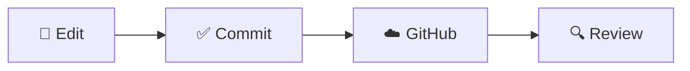

# 🛡️ Cyber Security 2026

### h0 — Hello, GitHub!


---

## 👋 Hello, world!

Welcome to my first GitHub Markdown page!

This page is part of the **Cyber Security 2026** course.
The purpose of this exercise is to explore GitHub,
Markdown formatting and the fundamentals of version control.

> Security begins with understanding the systems we use.

## 🔐 Information Security

Information security is commonly based on three principles:

| Principle | Description |
|:---|:---|
| 🔒 **Confidentiality** | Protect sensitive information |
| 🛡️ **Integrity** | Prevent unauthorized modifications |
| 🌐 **Availability** | Ensure systems remain accessible |

## 💻 Terminal

Git is a distributed version control system.

Some useful commands:

```bash
# Check repository status
git status

# View recent commits
git log --oneline -3

# Display installed Git version
git --version
```

Commands such as `git status` can be formatted
using **inline code**, while longer examples
use fenced code blocks.

## 🔄 Version Control Workflow



## 🎯 What I learned

- [x] Create a GitHub repository
- [x] Write a Markdown document
- [x] Format headings and paragraphs
- [x] Add code blocks and tables
- [x] Commit changes using GitHub
- [ ] Explore more advanced Git features

---

**Cyber Security 2026** · h0 Hello

*My first step into Git and version control.*


# Linux-Course
Homework reports for Linux course taught by Tero Karvinen
